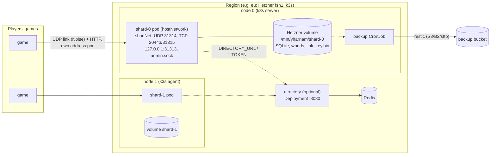

# Deploying the hosted server to a region

How the hosted shadNet (docs/HOSTED_SERVER.md) runs in production: one image, a Helm chart for
any Kubernetes, and Terraform for a whole region on Hetzner Cloud. A region is one or more
**shards**; a shard is one shadNet process with its own public address, link key, accounts,
worlds and volume. The single-box path (docker compose or systemd, `server/hosting/README.md`)
stays as it is and uses the same image.

| Path | What |
| --- | --- |
| `server/hosting/Dockerfile` | The one shadNet image (compose, the chart, CI) |
| `server/hosting/Dockerfile.backup` | The backup runner (`backup.sh`/`restore.sh`, restic, sqlite3) |
| `deploy/helm/yharnam/` | The chart; `values/<region>.yaml` per region, `values/kind.yaml` for the test |
| `deploy/terraform/` | `modules/region` (Hetzner + k3s + the chart), `modules/dns-cloudflare`, `root/`, `environments/<region>/`, `tf.sh` |
| `deploy/kind/` | The local cluster test (`smoke.sh`) |
| `.github/workflows/deploy.yml` | Optional CI: images to GHCR, chart lint, Terraform validate |

## Deploy a new region in 7 steps

1. **Image.** Push to `main` (or run the `Deploy files` workflow) and note the tag `sha-<commit>`;
   or build and push it yourself: `docker build -f server/hosting/Dockerfile -t
   ghcr.io/lkaniel/yharnam-shadnet:sha-<commit> .` from the repository root, protobuf submodule
   checked out. Every shard and every game runs this one build.
2. **Accounts.** A Hetzner Cloud project and API token (read/write), an SSH key uploaded to it,
   a bucket for backups (Backblaze B2, Hetzner Object Storage or any S3) and one for Terraform
   state, and optionally a Cloudflare zone and token (DNS edit).
3. **Copy a region:** `cp -r deploy/terraform/environments/eu deploy/terraform/environments/ap`
   and edit `terraform.tfvars` (region, location, shard count, server type, your addresses in
   `admin_cidrs`, the image tag, the backup repository) and the `key` in `backend.hcl`. Copy
   `deploy/helm/yharnam/values/eu.yaml` to `values/ap.yaml` and name it in
   `chart_values_files`.
4. **Secrets** in the environment, never in files:
   ```
   export TF_VAR_hcloud_token=...                 # Hetzner
   export TF_VAR_backup_password=...              # restic; keep a copy in your password manager
   export TF_VAR_backup_env='{AWS_ACCESS_KEY_ID="...",AWS_SECRET_ACCESS_KEY="..."}'
   export TF_VAR_cloudflare_api_token=...         # only with cloudflare_zone_id
   export AWS_ACCESS_KEY_ID=... AWS_SECRET_ACCESS_KEY=...   # the state bucket
   ```
5. **Apply:** `deploy/terraform/tf.sh ap init`, `tf.sh ap plan`, `tf.sh ap apply`. It makes the
   servers, volumes, network and firewall, waits for k3s, and installs the chart (~5 minutes).
6. **Keys.** For each shard, read its public key and save its key file off the cluster (below):
   `tf.sh ap output -raw kubeconfig > ~/.kube/yharnam-ap`, then
   `kubectl --kubeconfig ~/.kube/yharnam-ap -n yharnam exec yharnam-shard-0 -c shadnet -- shadnet --admin key`.
   Put the public keys in the launcher's `KNOWN_SERVER_KEYS` with the shards' names
   (`terraform output shard_names`) and ship the launcher.
7. **Check:** `bbload --server <shard address> --teams 1 --team-size 3 --seconds 30` from a machine
   outside (its games share one address there: more than 5 new accounts an hour from one address
   are refused), the admin `stats` and `players`, and the first backup
   (`kubectl -n yharnam create job --from=cronjob/yharnam-shard-0-backup first-backup`).

## Architecture



Each shard node is a Hetzner server with its own public IPv4/IPv6; its pod uses the node's network,
so a game talks to the shard with nothing in between. Nodes talk to each other over the private
network. Terraform's firewall opens only the game's ports to everyone and SSH and the Kubernetes
API to `admin_cidrs`.

### Ports

| Port | What | Public? |
| --- | --- | --- |
| 31314/udp | The games' link (hello, relay, worlds; Noise-encrypted) | yes |
| 20443/tcp | The game's online services (plain HTTP) | yes: the game calls it at its link's address |
| 31315/tcp | Summons and WebAPI (plain HTTP) | yes, as 20443 |
| 31313/tcp | The RPC listener | **no**: `TcpLocalOnly=true` binds 127.0.0.1; the games' calls reach it through the link's tunnel (`link_server.cpp` connects to LocalHost) |
| 31320/tcp | Stats page | no (`StatsEnabled=false`) |
| admin.sock | Operator commands | a file on the volume, only the server's user |
| 443, 8443/tcp | Optional TLS front (`tls.mode=caddy`) | when enabled |

### Why the players' own address and port must reach the pod

The server counts hellos, games and new accounts per source address, bans per address, and its
cookie is a keyed hash of the source address **and port** (docs/HOSTED_SERVER.md). Any NAT that
rewrites the source on the way in (kube-proxy with `externalTrafficPolicy: Cluster`, a proxy, a
Docker port mapping) makes every player one address: past 5 new accounts an hour and 8 games an
address the rest are refused, and one player's flood bans everyone. The kind test below shows
exactly that (5 of 12 games got in). So the chart has three
ways in, all keeping the source:

- `hostNetwork` (default; what Terraform uses): no NAT at all, one shard per node. Hetzner's load
  balancers carry no UDP, so this is the Hetzner way.
- `hostPort`: the CNI's portmap DNATs to the pod and keeps the source; one shard per node.
- `loadBalancer`: one Service a shard, UDP and TCP on one address, `externalTrafficPolicy: Local`
  (the node hands the datagram over unchanged; nodes without the pod fail the health check).

Each shard needs **its own** public endpoint: a player's link is one shard's for its whole session
(cookie, keys, world), so no load balancer may spread one address over several shards.

## The chart

`helm install yharnam deploy/helm/yharnam -n yharnam -f deploy/helm/yharnam/values/eu.yaml --set image.tag=sha-<commit>`

- **StatefulSet** `<release>-shard`, `shards.count` pods, a PVC each (`data-<release>-shard-<n>`,
  kept when the release is deleted or scaled down), `updateStrategy: OnDelete` (below), a
  PodDisruptionBudget with `maxUnavailable: 0`, required anti-affinity in the host modes, startup,
  readiness and liveness probes (`healthcheck.sh`: the admin socket's `stats`, which answers only
  while the event loop runs), non-root (10001), read-only root filesystem, no capabilities, no
  service account token, `RuntimeDefault` seccomp, no CPU limit (throttling shows as relay spikes).
- **Config**: `config` and `extraConfig` render `shadnet.cfg` (every `Hosted*` setting is there with
  its default); it is copied over `/data/shadnet.cfg` at each start. The chart sets the ports,
  paths, `Host=0.0.0.0` and `TcpLocalOnly=true` itself. `backendFiles` gives the services' notice,
  broadcast and login message.
- **Per-shard env**: `SHARD_NAME` (`<region>-<n>`), `SHARD_PUBLIC_ADDRESS` (`shards.publicAddresses[n]`,
  else the node's address), and with `directory.enabled` `DIRECTORY_URL` and `DIRECTORY_TOKEN`.
- **Link key import**: `shards.linkKey.existingSecret` with `shard-0.bin`, `shard-1.bin`, ... copies a
  key in only when the volume has none (moving an existing public server keeps its players' pins).
- **NetworkPolicy**: shards take only the game's ports and send only DNS (+ directory, + ACME);
  Redis takes only the directory. Most CNIs do not apply policies to hostNetwork pods: there the
  host firewall is what counts.
- **Directory** (`directory.enabled`, off by default): a Deployment (`ghcr.io/lkaniel/yharnam-directory`,
  port 8080, `directory.env` for its settings) with a PDB, its Service (optional Ingress), and a
  Redis without persistence; the token and Redis password are a Secret the chart makes once and
  keeps (`helm.sh/resource-policy: keep`), or `directory.existingSecret`.
- **Backups** (`backup.enabled`): a CronJob per shard (below).

### TLS for the HTTP ports

`tls.mode: caddy` adds a Caddy sidecar to each shard: TLS on 443 (to 20443) and 8443 (to 31315)
for the shard's public name, certificates from Let's Encrypt (TLS-ALPN) kept on the shard's
volume. `tls.mode: ingress` makes an Ingress per shard instead (for cert-manager and an ingress
controller). Both need DNS names in `shards.publicAddresses`.

What it does **not** do today: the games speak plain `http://` to 20443/31315 (the services URL
in ss.info is `http://<address>:<port>`), and the hosted HTTP check (`http_gate.h`) reads the TCP
connection's source address. Behind any proxy every request comes from the proxy, which no linked
game has, so only GETs (ss.info, status) pass. The plain ports therefore stay open, and the TLS
endpoint is for clients that speak HTTPS (the launcher's checks, a web page). Encrypting the
games' HTTP needs the game to use `https://` and shadNet to trust a forwarded address
(PROXY protocol from the sidecar would keep the gate exact); neither exists yet. The link itself
(accounts, secrets, relay) is already encrypted.

### Several shards, and the directory

`shards.count: N` runs N shards in the region; each is a whole server (its accounts, worlds, key,
volume and address), so a player belongs to the shard it signs in to. The directory (being built
on another branch: an HTTP service backed by Redis) is what tells launchers which shard to use;
the chart runs it with `directory.enabled` and hands each shard `DIRECTORY_URL`, `SHARD_NAME`,
`SHARD_PUBLIC_ADDRESS` and `DIRECTORY_TOKEN`, so the shards can register themselves. Grow a region
by raising `shard_count` in its tfvars (Terraform adds a server, a volume, a PV, the DNS name) and
applying; existing shards are not restarted. Shrinking keeps the last shard's volume (retained
PVC, `prevent_destroy` on the Hetzner volume): its players' accounts and worlds stay there until
you move or delete them by hand.

### Running the kind test

```
docker build -f server/hosting/Dockerfile -t yharnam-shadnet:local .
docker build -f server/hosting/Dockerfile --target loadtest -t yharnam-bbload:local .
docker build -f server/hosting/Dockerfile.backup -t yharnam-backup:local server/hosting
cmake --build <build> --target bbload
deploy/kind/smoke.sh <build>/bbload 90      # KIND_OOM_SHIM=1 on sandboxes like the test box
```

## The link key and backups

`link_key.bin` (the data folder; `LinkKeyFile`) is the server's identity: its private key. The
launcher ships each public server's public key (`KNOWN_SERVER_KEYS`) and every game pins it.
**Losing the file breaks every player's pin** (their games refuse the new key, and the launcher
says so) until a launcher with the new key is out; leaking it lets someone stand in for the
server. So:

- it lives on the shard's volume (a Hetzner volume survives the server being replaced; Terraform
  sets `prevent_destroy` on it) and is in every backup (`backup.sh` copies it with the config and
  `banned.txt`);
- right after the first start, copy it off the cluster too (NOTES.txt prints the command) into
  your password manager; restic's password goes next to it (without it the backups do not open);
- the entrypoint warns loudly when a data folder has accounts but no key;
- to move a server, bring the key with `shards.linkKey.existingSecret` or a restore.

Backups: `backup.enabled` runs `server/hosting/backup.sh` hourly per shard in the backup image, on
the shard's node with its volume mounted read-only: `sqlite3 .backup` of each database (checked
with `integrity_check`), each world's `journal.pb` before its `world.pb` (so a pair always replays
to a state the server had), the config, bans and key, a SHA-256 manifest, then `restic backup`
and `forget --prune` (48 hourly, 14 daily, 8 weekly, 12 monthly) to `<repository>/<region>-<n>`.
The Secret (`backup.existingSecret`; Terraform makes `yharnam-backup`) holds `RESTIC_PASSWORD`
and the target's keys (`AWS_*` for S3/B2/Hetzner Object Storage); a Hetzner Storage Box uses
`sftp:` and `backup.sshSecret`.

Restore a shard: the chart runs `restore.sh` as an init container of that shard's pod, before
shadNet starts, when `restore.shard` and a new `restore.id` are set (the current data goes to
`restore-aside/`, never deleted; each id runs once):

```
helm upgrade yharnam deploy/helm/yharnam -n yharnam --reuse-values \
  --set restore.shard=1 --set restore.id=2026-11-02 --set restore.snapshot=<id|latest>
kubectl -n yharnam delete pod yharnam-shard-1          # restores, then starts
kubectl -n yharnam logs yharnam-shard-1 -c restore
```

`restore.only=world:<folder>` restores one world. A snapshot without `link_key.bin` (one taken
after the key was lost) keeps the key the shard still has; `backup.sh` warns when it backs up a
folder with no key. Pick the snapshot by id rather than `latest` after an accident: the hourly job
may have backed up the damage already (the kind test ran into exactly that).

The restore drill in `server/hosting/README.md` applies unchanged (run it monthly).

## Operating a shard

The admin socket is inside the pod; `kubectl exec` is the operator's way in (Kubernetes RBAC
decides who may):

```
kubectl -n yharnam exec yharnam-shard-0 -c shadnet -- shadnet --admin players
kubectl -n yharnam exec yharnam-shard-0 -c shadnet -- shadnet --admin stats
kubectl -n yharnam exec yharnam-shard-0 -c shadnet -- shadnet --admin ban 203.0.113.7 7d flooding
kubectl -n yharnam exec yharnam-shard-0 -c shadnet -- shadnet --admin worlds
kubectl -n yharnam logs yharnam-shard-0 -c shadnet --since 1h
```

The commands are in `server/hosting/README.md` ("Operator commands"). Bans are written to
`banned.txt` on the volume and survive restarts.

## Upgrades: a maintenance window

Every game and every shard run one build (the link refuses other versions, and `HostedBuild`
pins the build the games must say), and a shard's restart drops every game on it. There is no
rolling upgrade that keeps players: an upgrade is a window.

1. Announce it (`backendFiles` broadcast/notice, a `helm upgrade` changes only the ConfigMap; the
   message shows after the next restart, so announce in the launcher/Discord ahead).
2. Release the launcher/game build and the server image from the same commit.
3. `helm upgrade` (or `tf.sh <region> apply` with the new `image_tag`). Pods do not restart:
   `updateStrategy: OnDelete`, and the PDB blocks drains.
4. At the window: `kubectl -n yharnam delete pod -l app.kubernetes.io/component=shard` (all shards at
   once, or one by one). Each stops with SIGTERM, drains its writer thread (journals fsynced),
   starts on the new image with the same volume and key; startup takes seconds plus world loading.
5. Check `stats` and `players` on each shard.

Kubernetes or OS upgrades of a node are the same: in the window, `kubectl drain` with
`--disable-eviction` or after setting `shards.pdb.enabled=false`. Terraform ignores changes to a
server's cloud-init so that a new k3s version never rebuilds a live shard by itself; replace a
node on purpose (`tf.sh <region> apply -replace='module.region.hcloud_server.node[1]'`) in a
window: its volume is reattached and its data, key included, comes back (the PersistentVolume is
static, pointing at the same folder).

## Terraform

`deploy/terraform/modules/region` makes, for one region: a private network and subnet, a spread
placement group, a firewall (UDP 31314, TCP 20443/31315 and `tls_ports` from everywhere; SSH and
6443 from `admin_cidrs`; ICMP), per shard a server (`server_type`, default `ccx13`) and an ext4
volume mounted at `/mnt/yharnam`, k3s by cloud-init (server on node 0, agents on the rest,
labelled `yharnam.dev/role=shard`; traefik, servicelb and local-storage off; UDP buffer sysctls;
no automatic reboots), the cluster's CAs and an admin client certificate (Terraform makes them,
cloud-init places them before k3s first starts, so the helm and kubernetes providers authenticate
without fetching a kubeconfig), a static PersistentVolume per shard on its volume, the backup
Secret and the Helm release. `modules/dns-cloudflare` adds `s<n>.<region>.<zone>` A/AAAA records
(unproxied); with another DNS host, replace that module (same inputs, a `names` output) or set the
records by hand and leave `cloudflare_zone_id` empty (the shards are then published by IP).

`root/` is the one root module; `environments/<region>/` holds only `terraform.tfvars` and
`backend.hcl`, and `tf.sh <region> <command>` runs the root with that region's variables, state
and `.terraform-<region>` folder. Adding a region is copying that folder.

### Terraform state

Remote, one state file a region, in any S3-compatible bucket (`backend.hcl`: bucket, key
`regions/<region>.tfstate`, endpoint; credentials from `AWS_ACCESS_KEY_ID`/`AWS_SECRET_ACCESS_KEY`).
The example uses Hetzner Object Storage (`https://fsn1.your-objectstorage.com`); B2 and R2 work the
same way. Turn on bucket versioning. With Terraform >= 1.10 set `use_lockfile = true` for locking;
older versions have none on non-AWS S3, so run one apply a region at a time. The state holds the
cluster CAs and admin key and the backup credentials: the bucket must be private, and readable
only by the operators and CI. Lock files (`.terraform.lock.hcl`) are not committed; make one for
every platform you run from with `terraform providers lock -platform=linux_amd64 -platform=darwin_arm64`.

## Any other Kubernetes (GKE, EKS, AKS, ...)

Use `shards.expose: loadBalancer` (one LoadBalancer Service per shard, UDP 31314 + TCP 20443/31315
on one address, `externalTrafficPolicy: Local`), fill `shards.publicAddresses` with the addresses
or DNS names once they exist, and pick the provider's block storage class (`premium-rwo`, `gp3`,
`managed-csi-premium`). Mixed UDP/TCP on one LoadBalancer is GA since Kubernetes 1.26 but each cloud
decides whether it supports it:

| Cloud | Settings (shards.loadBalancer.annotations) | Client address |
| --- | --- | --- |
| GKE | passthrough Network LB (the default for `type: LoadBalancer`); for mixed protocols the backend-service NLB `cloud.google.com/l4-rbs: "enabled"`; reserve static IPs and put them in `perShard[n].loadBalancerIP` | kept with `Local` |
| EKS | AWS Load Balancer Controller: `service.beta.kubernetes.io/aws-load-balancer-type: external`, `...-nlb-target-type: ip`, `...-scheme: internet-facing`; NLB supports UDP and TCP on one listener set | kept with target type `ip` (or `instance` + `Local`) |
| AKS | Standard LB, `service.beta.kubernetes.io/azure-load-balancer-resource-group` / static public IPs per shard | kept with `Local` |

If a cloud refuses mixed protocols, run the shards with `hostNetwork` or `hostPort` on a dedicated
node pool with public IPs (`shards.nodeSelector`, `tolerations`), as on Hetzner. Never put an
L7 or TCP proxy, Cloudflare's proxy or a service mesh sidecar in front of 31314.

## Costs per region (Hetzner, approximate)

Prices change; check hetzner.com/cloud. Approximate list prices in 2025, without VAT:

| Item | EU (fsn1/nbg1/hel1) | US (ash/hil) | Singapore (sin) |
| --- | --- | --- | --- |
| Shard server `ccx13` (2 dedicated vCPU, 8 GB) | ~13 EUR/month | ~15 EUR | ~16 EUR |
| or `cpx21` (3 shared vCPU, 4 GB; fine for a few hundred players) | ~8 EUR | ~9 EUR | ~10 EUR |
| Volume 20 GB | ~1 EUR | ~1 EUR | ~1 EUR |
| Primary IPv4 | ~0.6 EUR | ~0.6 EUR | ~0.6 EUR |
| Included traffic a server | 20 TB | 1 TB | 0.5 TB |
| Extra traffic | ~1 EUR/TB | ~1 EUR/TB | ~7 EUR/TB |
| Backups (B2, a few GB) | < 0.1 EUR | < 0.1 EUR | < 0.1 EUR |

One shard: ~15 EUR a month in the EU, ~17 in the US, ~18 in Singapore before traffic; each extra
shard adds about the same. Traffic: a player sends and receives ~10 KB/s, so 500 players around the
clock are ~25 Mbit/s out, ~8 TB a month: within the EU's 20 TB, a real cost in the US and
Singapore (~7 TB over: ~7 EUR in the US, ~50 EUR in Singapore). Terraform state on Hetzner Object
Storage is ~6 EUR a month for the account (shared by every region).

## What was tested, and what not

Tested on 2026-10-23 on one 4-core cloud box:

- **Image** (`docker build` from the repository root, conda Qt): 255 MB on disk, 69 MB compressed;
  runs as 10001, makes `link_key.bin` (0600) on first start, Docker reports it healthy, bbload's
  games link and play against it (3 games, 20-bit work), SIGTERM stops it in 0.3 s with exit 0, and
  the key is the same after a restart. The backup image builds and runs restic 0.16.4.
- **Chart** on kind (Kubernetes 1.31.2, `deploy/kind/smoke.sh`, run end to end from a fresh
  cluster): `helm lint` and `helm template` for every values file, install, probes, the key made
  on the PVC, then
  - 12 games from the host through kind's port mapping (Docker NAT: every game 172.18.0.1): only
    **5 linked**, 7 accounts and 16 hellos refused by the per-address limits. This is what a NAT in
    front of a shard does to real players;
  - with `hostNetwork`, 90 games each from its own address: **90/90 linked and playing**, relay
    p50 1.4-1.7 ms, p99 6-9 ms, ~0.1-0.2% lost, link thread 9%, no refusals;
  - the backup job (sqlite `.backup` from the read-only mount while shadNet writes, 31 worlds,
    restic snapshot), then the key deleted and the restore init container bringing back the same
    key; a restore of a snapshot without a key keeping the live one;
  - `helm uninstall` keeping the PVC (the same key on reinstall), two shards (`loadBalancer` mode,
    per-shard Services, `SHARD_NAME` and `SHARD_PUBLIC_ADDRESS` per ordinal, shard-1's key imported
    from `shards.linkKey.existingSecret`), the Caddy sidecar with its internal CA proxying 443 and
    8443 to shadNet, and the directory with a stand-in image reaching Redis with its password and
    reached from a hostNetwork shard at `DIRECTORY_URL`.
- **Terraform**: `terraform fmt -check` and `terraform validate` (providers from a local mirror:
  registry.terraform.io was blocked here), and `terraform plan` with a dummy Hetzner token for the
  EU example (25 resources; 29 with Cloudflare DNS). The custom-CA scheme against a k3s v1.31.2
  container: k3s took Terraform's server and client CAs and generated the rest, its API verified
  with the server CA, and the admin certificate is cluster-admin.

Quirks of the test box, not of the deployment: kind's pods only started with `runc-oom-shim.sh`
(the sandbox may not lower `oom_score_adj`; `KIND_OOM_SHIM=1`), multi-platform images had to be
rebuilt single-platform for `kind load`, and kindnet did not enforce the NetworkPolicies (they
apply cleanly; enforcement is untested).

Not tested:
- Anything on Hetzner: `terraform apply`, the cloud-init (volume mount, private interface, k3s
  install, node labels), the firewall, static PersistentVolumes on a real volume, the helm
  provider against a live cluster, DNS records.
- GKE/EKS/AKS and the `loadBalancer` mode (rendered only).
- Real certificates (ACME) for the Caddy front; the Ingress front beyond rendering.
- restic against a real S3/B2/sftp target.
- The directory itself: its image does not exist yet (another branch builds it); only the wiring
  was run, with a stand-in.
- The aqtinstall Qt source (`QT_FROM=aqt`): download.qt.io was blocked here.
- The CI workflow has not run (the repository has no CI runner set up for it).
- A real game against the deployed shard (only bbload's simulated games), and more than 90
  players on the cluster (docs/HOSTED_SERVER.md has the 1000-player runs of the same binary).
- `docker compose up` with the new image (only `docker compose config`).
